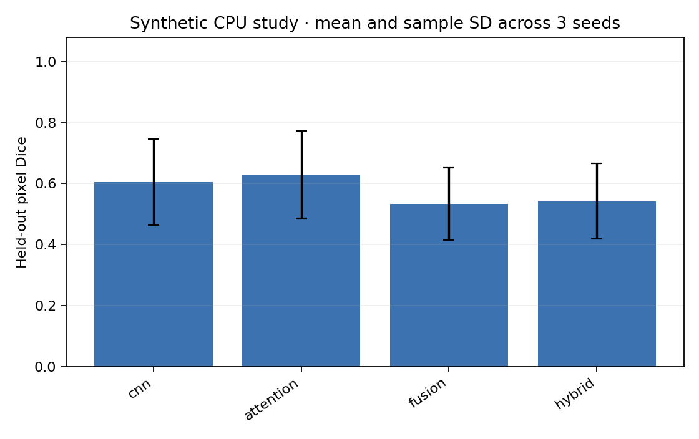
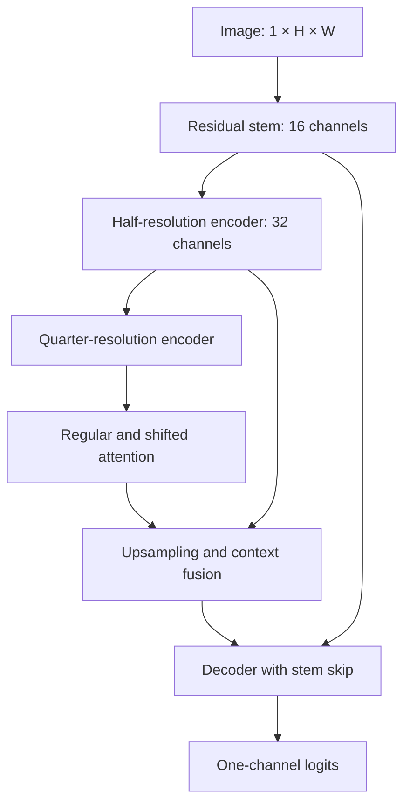

# Surface defect segmentation: CNN, window attention and context fusion

A reproducible architecture study for pixel-level surface inspection. A residual CNN is compared with local shifted-window attention, cross-scale context fusion, and their combination. The implementation exposes the attention equations, masking, loss, checkpoint selection and failure cases.

The central question is whether additional context improves small defect masks under a fixed training budget. The recorded experiment does **not** show a consistent advantage for the combined model. That outcome is retained alongside all three seeds and the simpler baseline.



## What is implemented

- Four experiment cells: CNN, CNN with attention, CNN with fusion, and the combined model.
- Explicit Q/K/V projections, learned relative-position bias, alternating regular/shifted windows, cyclic-boundary masking and padded-key masking.
- Fine-grid queries attending to 16 pooled context tokens, residual convolutions, GroupNorm and a high-resolution decoder skip.
- Focal plus per-image soft-Dice loss, validation-only model/threshold selection, saved checkpoints and per-image test CSVs.
- Audited local-image manifests, deterministic procedural data, CPU timings, three random initializations and worst-case visualizations.

## Run locally

Tested with Python 3.12.14, PyTorch 2.5.1+cpu and NumPy 2.3.5. Each repository is intended for its own virtual environment.

```bash
python -m venv .venv
```

Activate it with `source .venv/bin/activate` on Linux/macOS, or `.venv\Scripts\Activate.ps1` in Windows PowerShell. Then:

```bash
python -m pip install torch==2.5.1 --index-url https://download.pytorch.org/whl/cpu
python -m pip install -e ".[dev]"
python -m pytest -q
python -m visionseg.run --config configs/smoke.json --out runs/smoke
python -m visionseg.run --config configs/demo.json --out runs/reproduction
python tools/report.py --results runs/reproduction
```

The smoke configuration checks the complete pipeline quickly. The demo trains four variants for six epochs over three seeds. It uses 128 training, 48 validation and 80 test images at 64×64 pixels. Data split seeds remain fixed; initialization and training order vary across seeds. Generated masks come directly from procedural geometry.

## Architecture and tensor flow



For each window, attention is `softmax(Q Kᵀ / sqrt(d) + B + M) V`. `B` is a learned relative-position bias; `M` excludes padded keys and cyclic wrap-around connections. Alternating shift sizes of 0 and 2 connect adjacent windows on the next block. The network uses these established attention ideas in a small custom encoder; it is not a complete Swin backbone.

Cross-scale fusion uses queries at half resolution and keys/values from a 4×4 pooled context grid. Each query attends to 16 context tokens. This limits the attention matrix while retaining the fine-resolution convolutional branch for localization. Pooled context may still discard small defects, so fusion is an ablation factor rather than an assumed improvement.

## Recorded results

| Variant | Parameters | Test Dice, mean ± sample SD |
|---|---:|---:|
| CNN | 45,681 | 0.6046 ± 0.1410 |
| Attention | 63,161 | 0.6294 ± 0.1441 |
| Fusion | 49,905 | 0.5339 ± 0.1190 |
| Attention + fusion | 67,385 | 0.5425 ± 0.1245 |

See [the complete experiment report](results/demo/EXPERIMENTS.md) for precision, recall, IoU, paired changes and timing. These are measured **synthetic CPU results**, not external benchmark or production measurements. Extra parameters and different initialization paths remain confounders. Three seeds show substantial instability; a small mean difference is insufficient evidence of a general architectural gain.

At every epoch, predictions are collected on validation images. The best validation Dice across the configured threshold grid chooses both checkpoint and threshold. That selected pair is evaluated on test images. Test results never feed the training loop. Global Dice aggregates TP/FP/FN; per-image records and per-defect-kind summaries expose failures that a single aggregate can hide.

## Inspect predictions

Checkpoints from the recorded run are included. To create a local example image and apply one:

```bash
python tools/export_dataset.py --out data/example
python tools/validate_data.py --root data/example
python -m visionseg.infer --checkpoint results/demo/cnn_seed7.pt --image data/example/test/0001.png --out runs/prediction
```

Inference saves a probability PNG, binary mask and JSON. The output stays at the configured training resolution; mapping a low-resolution prediction back to a large image cannot recover discarded defects.

## Use private data

Prepare `manifest.csv` as described in [DATA_CONTRACT.md](docs/DATA_CONTRACT.md). Split by physical component or production batch before cropping or augmentation. The audit rejects exact image-content and group leakage across partitions.

```bash
python tools/validate_data.py --root /path/to/category
python -m visionseg.run --root /path/to/category --config configs/demo.json --out runs/private_category
```

Set a larger `size` in a copied configuration when small defects would disappear. The current loader resizes images; it does not implement a native-resolution tiling and stitching system.

## Code and reading order

| File | Purpose |
|---|---|
| [model.py](src/visionseg/model.py) | Residual blocks, masked windows, context fusion and loss |
| [run.py](src/visionseg/run.py) | Training, selection, evaluation and artifact generation |
| [data.py](src/visionseg/data.py) | Generator, CSV audit and paired-image loading |
| [infer.py](src/visionseg/infer.py) | Single-image checkpoint inference |
| [Technical guide, German](docs/TECHNICAL_GUIDE_DE.md) | Equations, design choices and review questions |
| [Model card](docs/MODEL_CARD.md) | Intended use, evidence and limits |

Tests cover token-order reversal, shifted-boundary isolation, padding gradients, non-square inputs, empty masks and data separation. The repository includes a GitHub Actions test workflow; local test execution is recorded in the portfolio validation report. Remote CI has not been run by packaging these files.

## References

- [Vaswani et al., Attention Is All You Need](https://arxiv.org/abs/1706.03762).
- [Liu et al., Swin Transformer](https://arxiv.org/abs/2103.14030).
- [Lin et al., Focal Loss for Dense Object Detection](https://arxiv.org/abs/1708.02002).
- [Ronneberger et al., U-Net](https://arxiv.org/abs/1505.04597).
