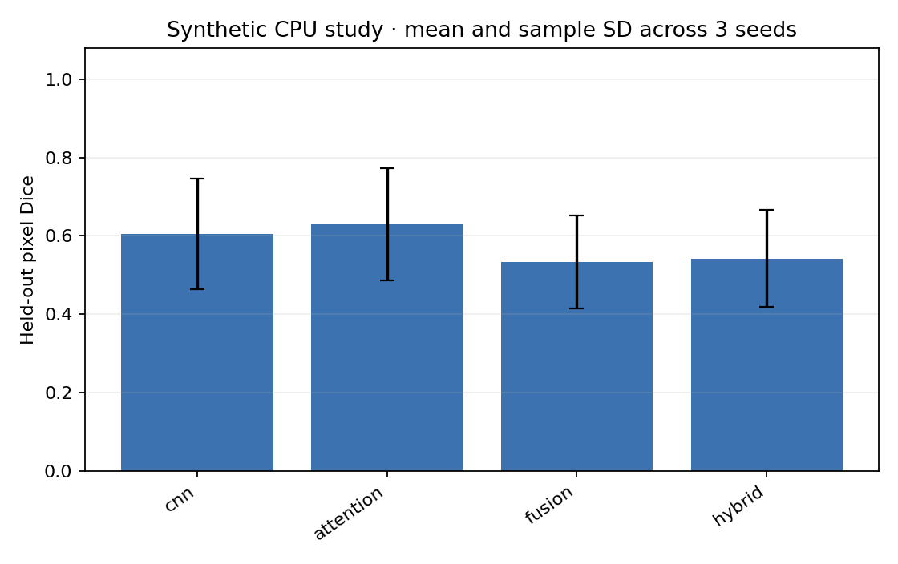

# Recorded experiments

Data: **procedural synthetic only**. Seeds: `[7, 17, 27]`. Measurement recorded: `2026-11-24T19:19:53.745086+00:00`.

| Variant | Parameters | Test Dice (mean ± SD) | Test IoU | Precision | Recall | CPU median ms |
|---|---|---|---|---|---|---|
| cnn | 45681 | 0.6046 ± 0.1410 | 0.4425 | 0.7221 | 0.5572 | 2.754 |
| attention | 63161 | 0.6294 ± 0.1441 | 0.4698 | 0.7163 | 0.5985 | 3.894 |
| fusion | 49905 | 0.5339 ± 0.1190 | 0.3705 | 0.6695 | 0.4794 | 2.821 |
| hybrid | 67385 | 0.5425 ± 0.1245 | 0.3792 | 0.6700 | 0.5050 | 6.073 |

The four cells form an attention × context-fusion ablation. Extra modules change parameter count and random-number consumption. Three seeds describe sensitivity; they do not establish statistical superiority. All seeds use the same held-out procedural test set. Selection used validation Dice only.

- attention: paired Dice change versus CNN = 0.0249 ± 0.2225.
- fusion: paired Dice change versus CNN = -0.0706 ± 0.1341.
- hybrid: paired Dice change versus CNN = -0.0621 ± 0.1339.

## Reproduction record

The complete configuration, data audit, runtime versions, source SHA-256, raw per-run metrics and available per-image CSVs are retained beside this report. CPU batch size, warm-up and repeat counts are stored with each timing. A source digest identifies the package Python files used for the recorded run. Model checkpoints contain tensors and inference metadata; optimizer state is intentionally omitted.

## Practical limits

Procedural defects have a narrow appearance distribution and exact generated masks. High scores on this generator do not establish performance on real materials, cameras, lighting, unseen defect types or production batches. Test images were used for the reported comparisons; choose any future production model using a separate validation protocol and reserve another untouched real test set.
